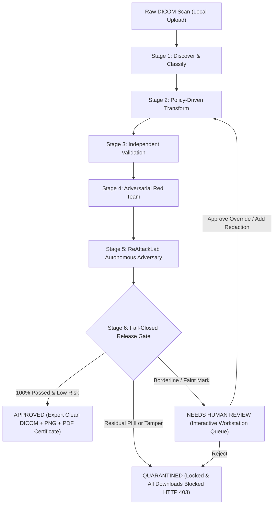

# SentinelDICOM VeilGuard

> **Sovereign, local-first DICOM de-identification and fail-closed release-control system.**  
> *"Remove private patient details from medical scans, and prove it's safe."*

[](https://sentineldicom-veilguard.onrender.com)
[](https://python.org)
[](https://fastapi.tiangolo.com)
[](https://react.dev)
[](https://www.typescriptlang.org)
[](#automated-test-suite)
[](#)

---

## 🌐 Live Deployed Prototype

The full system is deployed live in a production container on Render:

🔗 **[https://sentineldicom-veilguard.onrender.com](https://sentineldicom-veilguard.onrender.com)**

Try all 4 synthetic clinical scenarios directly in your browser:
- **Sample 1: Cranial CT Trauma Scan** $\rightarrow$ `APPROVED` (Clean DICOM + PNG export)
- **Sample 2: Chest Radiograph with QR Code** $\rightarrow$ `APPROVED` (QR zeroed, lung/ribcage byte-invariant)
- **Sample 3: Cardiac Ultrasound (Borderline Mark)** $\rightarrow$ `NEEDS HUMAN REVIEW` (Review queue & sign-off)
- **Sample 4: Adversarial Penetration Attack** $\rightarrow$ `QUARANTINED` (Exploit detected, download locked)

---

## The Problem

Medical DICOM scans contain Protected Health Information (PHI) across three vulnerable surfaces:
1. **Standard Metadata Headers**: Patient Name, MRN, Birth Dates, Performing Physician, Institution Addresses.
2. **Private Vendor Elements**: Proprietary odd-numbered group tags (`0x0009`, `0x0019`, `0x0029`) where CT and MRI scanners inject confidential notes, insurance data, and unstandardized VIP identifiers.
3. **Pixel Rasters**: Burned-in annotations (ultrasound technician initials, hospital stamps) and 1D/2D optical codes (patient QR badges) embedded directly into diagnostic pixel matrices.

Naive tag-stripping tools either miss burned-in text and private tags, or indiscriminately delete essential spatial geometry (`PixelSpacing`, `SliceThickness`, `ImagePositionPatient`), breaking downstream 3D reconstruction and AI pipelines.

**SentinelDICOM VeilGuard** solves this with a **sovereign local-first architecture** and a **fail-closed release gate**: scans are assumed untrusted and locked until independently audited, adversarially red-teamed, and verified by ReAttackLab.

---

## 5-Stage Core Pipeline + ReAttackLab



### Stage 1: Discover & Classify (`backend/discover`)
- Recursively inspects standard metadata elements, private odd-group tags, and nested requisition sequences (`RequestAttributesSequence`).
- Multi-engine pixel scanner combining Tesseract OCR with multi-contrast morphological stroke analysis (Top-Hat + High Contrast) for burned-in annotations.
- Computer vision finder-pattern scanner for 1D linear barcodes and 2D QR matrix codes.
- Generates categorized findings with bounding box coordinates, confidence scores, and severity classifications.

### Stage 2: Policy-Driven Transform (`backend/transform`)
- Executes declarative YAML policies (`Strict Research Release`, `Internal Sharing`, `Teaching File`).
- Precision solid black-box pixel masking with border padding, guaranteeing diagnostic pixels outside redaction boxes remain **100% byte-identical**.
- Consistent HMAC-SHA256 pseudonym UID remapping: `StudyInstanceUID`, `SeriesInstanceUID`, and `SOPInstanceUID` retain referential integrity across multi-scan datasets without leaking original institutional identifiers.
- Preserves essential clinical attributes (`Modality`, `PixelSpacing`, `SliceThickness`, `WindowCenter`, `WindowWidth`).
- Injects standard DICOM PS 3.15 de-identification tags (`PatientIdentityRemoved="YES"`).

### Stage 3: Independent Validation (`backend/validate`)
- Separate verification module with **zero shared logic** with the transform engine.
- Re-scans sanitized output from scratch for any residual PHI in metadata, private tags, or pixel rasters.
- Audits dimensional invariance, DICOM Part 10 preamble validity, and pixel integrity outside declared redactions.

### Stage 4: Adversarial Privacy Red Team (`backend/redteam`)
- Simulates an external attacker attempting patient re-identification.
- Executes fuzzy token inversion, high-contrast residual stroke probing, optical barcode frequency reconstruction, and demographic outlier scans.
- Quantifies an empirical **Re-Identification Risk Score** ($0.0$ to $100.0$).

### Stage 5: ReAttackLab Autonomous Adversary (`backend/reattack`)
- Autonomous adversarial self-check executing 5 specialized penetration vectors:
  1. **Optical Residual & Ghost Stroke Attack**: Applies multi-contrast CLAHE, Top-Hat high-pass, and edge-gradient penetration across post-redaction coordinates. Triggers **autonomous self-healing** if faint stroke remnants are detected.
  2. **Reverse Metadata & UID Pseudonym Inversion**: Probes all 27 core tags and odd-numbered private elements against target identity tokens.
  3. **Optical 2D QR Code & Barcode Residual Attack**: High-pass filtering to guarantee zero survivor finder patterns or recoverable QR modules.
  4. **High-Frequency & Steganographic LSB Re-Attack**: Scans redaction zones for covert LSB data or residual frequency entropy.
  5. **Diagnostic Anatomical Byte-Invariance Assurance**: Verifies that diagnostic anatomy (skull, brain parenchyma, lung fields, bone) outside redacted masks has exactly 0.0% pixel tampering.

### Stage 6: Fail-Closed Release Gate (`backend/gate`)
- **`APPROVED`**: All independent validation checks pass, ReAttackLab verdict is `IMMUNE` or `AUTO_HEALED`, risk score $< 15.0$, detection confidence $\ge 80\%$. File download authorized.
- **`NEEDS_REVIEW`**: Borderline detection confidence (e.g., $74\%$ on subtle sonographer mark). Scan routed to Clinical Review Queue for manual inspection, approval override, or extra redactions.
- **`QUARANTINED`**: Any validation failure, exploit payload, or risk score $\ge 40.0$. Scans locked in quarantine vault; all file downloads strictly blocked with **HTTP 403 Forbidden**.

---

## 🔒 Cryptographic Audit Hash Ledger

Every system action is recorded into an append-only ledger sealed with **SHA-256 cryptographic hash chaining**:

$$\text{Block Hash} = \text{SHA-256}(\text{Prev Hash} \parallel \text{Timestamp} \parallel \text{Actor} \parallel \text{Action} \parallel \text{Input Hash} \parallel \text{Output Hash} \parallel \text{Details})$$

Clicking **"Verify Audit Integrity"** (`GET /api/audit/verify`) recalculates the hash chain from genesis to head, proving zero tampering across the database.

---

## 📁 Repository Structure

```
SentinelDICOM-VeilGuard/
├── backend/
│   ├── app.py                      # FastAPI REST API, static SPA server & route handlers
│   ├── config.py                   # Storage paths, cryptographic salts & environment config
│   ├── database.py                 # SQLite schema & database connection management
│   ├── dicom_utils.py              # DICOM Part 10 I/O, windowing, PNG rasterizer & byte hashing
│   ├── pipeline.py                 # Core 6-stage pipeline orchestrator with latency telemetry
│   ├── discover/                   # Stage 1: metadata scanner, OCR & QR/barcode detectors
│   │   ├── metadata_scanner.py
│   │   └── pixel_scanner.py
│   ├── transform/                  # Stage 2: policy transform, UID remapper, pixel redactor
│   │   ├── policy_engine.py
│   │   ├── uid_remapper.py
│   │   └── pixel_redactor.py
│   ├── validate/                   # Stage 3: independent 8-point validation checklist
│   │   └── independent_validator.py
│   ├── redteam/                    # Stage 4: adversarial privacy penetration suite
│   │   └── adversarial_tester.py
│   ├── reattack/                   # Stage 5: ReAttackLab 5-vector autonomous adversary
│   │   └── reattack_lab.py
│   ├── gate/                       # Stage 6: fail-closed release gatekeeper
│   │   └── release_gate.py
│   ├── audit/                      # Cryptographic hash ledger & PDF certificate generator
│   │   ├── hash_chain.py
│   │   └── report_generator.py
│   └── samples/                    # Synthetic clinical DICOM generators
│       └── sample_generator.py
├── frontend/                       # React 19 + TypeScript + Vite + Tailwind CSS Single Page App
│   ├── src/
│   │   ├── components/             # FindingsCanvas, DiffViewer, ReviewQueue, AuditLedger, etc.
│   │   ├── types.ts                # TypeScript domain models
│   │   ├── App.tsx                 # Master state & navigation router
│   │   └── index.css               # Sovereign medical dark-mode styling
│   ├── package.json
│   └── vite.config.ts
├── policies/                       # Declarative YAML de-identification policies
│   ├── hipaa_safe_harbor.yaml      # HIPAA Safe Harbor (45 CFR § 164.514(b))
│   ├── strict_research.yaml        # Maximum privacy research release profile
│   ├── internal_sharing.yaml       # Multi-center collaborative institutional policy
│   └── teaching_file.yaml          # Clinical education profile preserving anatomy labels
├── tests/                          # 13 automated unit & penetration tests
│   ├── conftest.py
│   ├── test_discover.py
│   ├── test_transform.py
│   ├── test_validate.py
│   ├── test_redteam.py
│   ├── test_reattack.py
│   └── test_fail_closed.py
├── storage/                        # Persistent storage (isolated uploads, sanitized, quarantine)
├── Dockerfile                      # Production multi-stage Docker build
├── docker-compose.yml              # Local multi-service orchestration
├── render.yaml                     # Render infrastructure-as-code specification
├── requirements.txt                # Python backend dependencies
└── README.md
```

---

## 🚀 Quickstart Guide

### Option 1: Local Development

#### 1. Backend Setup
```bash
# Clone the repository
git clone https://github.com/greeshmareddy683-pixel/SentinelDICOM-VeilGuard.git
cd SentinelDICOM-VeilGuard

# Install Python dependencies
pip install -r requirements.txt

# Start backend server
python -m uvicorn backend.app:app --host 127.0.0.1 --port 8000 --reload
```
*Backend API and interactive docs live at `http://127.0.0.1:8000/docs`.*

#### 2. Frontend Setup (Optional for Dev)
```bash
cd frontend
npm install
npm run dev
```
*Vite dev server runs at `http://localhost:5173` with automatic API proxy.*

---

### Option 2: Docker Setup

```bash
docker compose up --build
```
- Web Application: `http://localhost:8000`
- API Documentation: `http://localhost:8000/docs`

---

## 🧪 Automated Test Suite

Run the full automated test suite covering all pipeline stages, pixel invariance, ReAttackLab vectors, and fail-closed security:

```bash
python -m pytest tests/ -v
```

Expected output:
```
============================= test session starts =============================
collected 13 items

tests/test_discover.py::test_discover_cranial_ct_planted_phi PASSED      [  7%]
tests/test_discover.py::test_discover_chest_xray_qr_code PASSED          [ 15%]
tests/test_fail_closed.py::test_fail_closed_quarantine_behavior PASSED   [ 23%]
tests/test_fail_closed.py::test_audit_hash_chain_tamper_detection PASSED [ 30%]
tests/test_reattack.py::test_reattack_suite_clean_scan PASSED            [ 38%]
tests/test_reattack.py::test_reattack_detects_unredacted_tokens PASSED   [ 46%]
tests/test_reattack.py::test_pipeline_records_reattack_results PASSED    [ 53%]
tests/test_redteam.py::test_redteam_low_risk_on_clean_scan PASSED        [ 61%]
tests/test_redteam.py::test_redteam_high_risk_on_leaked_target_tokens PASSED [ 69%]
tests/test_transform.py::test_transform_metadata_and_consistent_uid PASSED [ 76%]
tests/test_transform.py::test_transform_pixel_redaction_and_byte_invariance PASSED [ 84%]
tests/test_validate.py::test_independent_validator_passes_on_clean PASSED [ 92%]
tests/test_validate.py::test_independent_validator_catches_residual_phi PASSED [100%]

======================= 13 passed in 6.07s =======================
```

---

## 🎬 Interactive Demo Walkthrough

### Scenario 1: Standard Clinical Release (Cranial CT)
1. Open the [Live Prototype](https://sentineldicom-veilguard.onrender.com).
2. Click **"Run"** under **"Cranial CT Trauma Scan"**.
3. Watch the live stage progress: Discover $\rightarrow$ Transform $\rightarrow$ Validate $\rightarrow$ Red Team $\rightarrow$ ReAttackLab $\rightarrow$ Release Gate.
4. Review the **Findings Canvas**: burned-in header text recognized and bounded.
5. Inspect the **Before/After Diff**: verify solid zeroing of PHI and preserved cranial calvarium.
6. Verify the **APPROVED** verdict, and click **"Export Certificate (PDF)"** to download the signed release document.

### Scenario 2: Optical Barcode Challenge (Chest Radiograph)
1. Launch **"Chest Radiograph DX with Planted QR Code"**.
2. Observe that SentinelDICOM isolates both burned-in header text and the scannable 2D QR matrix in the bottom corner.
3. Verify that the QR code is masked with zero survivor patterns, while lung tissue and ribcage remain 100% byte-invariant.

### Scenario 3: Borderline Confidence & Human Review Queue
1. Launch **"Ultrasound Cardiac (Borderline Annotation)"**.
2. Observe the amber **"NEEDS HUMAN REVIEW"** banner (74% confidence on subtle sonographer mark).
3. Open the **Review Queue**: examine the highlighted margin mark.
4. Click **"Sign-Off & Approve Release"** $\rightarrow$ Gate transitions to **APPROVED** and unlocks file downloads.

### Scenario 4: Adversarial Exploit & Fail-Closed Quarantine
1. Launch **"Adversarial Attack & Integrity Tamper"**.
2. Notice the red **"QUARANTINED"** verdict (Risk: 85.0/100, corrupted exploit payload detected).
3. Attempt to download the scan: the system immediately aborts with **HTTP 403 Forbidden**, proving that unapproved data can never leak.

---

## 📜 Regulatory Standards Conformance

- **HIPAA Privacy Rule**: Complies with the Safe Harbor method (45 CFR § 164.514(b)) and Expert Determination standard.
- **DICOM PS 3.15 Annex E**: Implements Application Level Confidentiality Basic Profile with clean UID pseudonymization.
- **Fail-Closed Principle**: Zero data export without positive multi-stage clearance.
- **WCAG 2.1 AA**: Accessible medical UI with high-contrast ratios, dual visual status cues, and responsive viewport sizing.

---

## 📄 License

Licensed under the [Apache License, Version 2.0](LICENSE).
