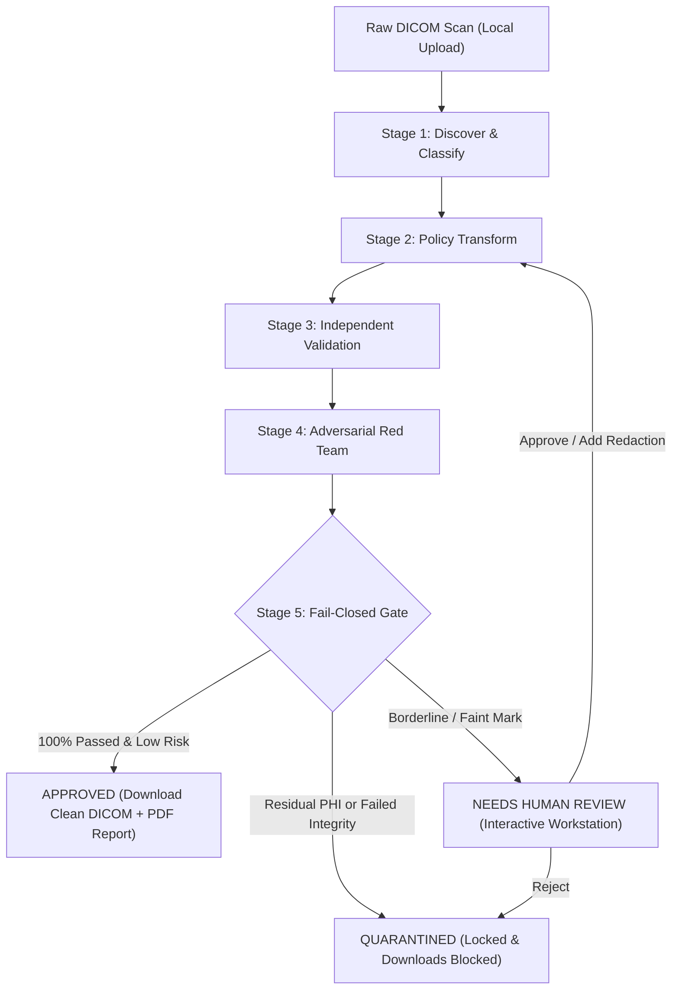

# SentinelDICOM VeilGuard

> **Sovereign, local-first DICOM de-identification and fail-closed release-control system.**  
> *"Remove private patient details from medical scans, and prove it's safe."*

[](https://python.org)
[](https://fastapi.tiangolo.com)
[](https://react.dev)
[](https://www.typescriptlang.org)
[](#)

---

## The Problem

Medical DICOM scans contain Protected Health Information (PHI) across three vulnerable surfaces:
1. **Metadata Headers**: Standard patient tags, physician notes, and dates.
2. **Private Vendor Elements**: Odd-numbered group tags (`0x0009`, `0x0019`, `0x0029`) where CT and MRI scanners inject proprietary data, patient VIP tags, and unstandardized notes.
3. **Image Pixels**: Burned-in patient names, timestamps, acoustic calibration tags, and optical 1D/2D barcodes (such as QR codes) stamped into pixel rasters.

Simple tag-stripping tools miss burned-in text and private tags, or indiscriminately delete essential geometry tags (breaking 3D reconstruction and AI models). 

**SentinelDICOM VeilGuard** is engineered with a **fail-closed release gate**: scans are assumed dangerous until independently audited, adversarially red-teamed, and verified.

---

## 5-Stage Core Pipeline



1. **Discover & Classify (`backend/discover`)**:
   - Recursively traverses standard DICOM elements, private odd-group vendor tags, and nested requisition sequences.
   - Runs OCR and optical QR/barcode matrix detectors on pixels (multi-frame, secondary capture, ultrasound).
   - Generates confidence scores, severity ratings, and bounding boxes.

2. **Policy-Driven Transform (`backend/transform`)**:
   - Executes editable YAML policies (`Strict Research Release`, `Internal Sharing`, `Teaching File`).
   - Solid black-box pixel masking with border padding (preserving diagnostic pixels outside boxes **100% byte-identical**).
   - Consistent HMAC-SHA256 UID remapping so Study/Series/Instance references remain valid across datasets.
   - Retains essential clinical tags (`Modality`, `PixelSpacing`, `SliceThickness`, `WindowCenter`, `WindowWidth`).
   - Injects DICOM PS 3.15 standard attributes (`PatientIdentityRemoved="YES"`).

3. **Independent Validation (`backend/validate`)**:
   - Separate verification module with **zero shared logic** with transform.
   - Re-scans output from scratch for any residual PHI in tags, sequences, or pixels.
   - Verifies dimension invariance, file validity, and byte-level pixel stability.

4. **Adversarial Red Team (`backend/redteam`)**:
   - Simulates malicious re-identification: fuzzy search for original target tokens, upscaled multi-scale OCR with adaptive edge equalization, optical barcode frequency analysis, and demographic outlier scans.
   - Generates a quantified **Re-Identification Risk Score** (0 to 100).

5. **Fail-Closed Release Gate (`backend/gate`)**:
   - **APPROVED**: 100% validation passed, risk score < 15, no low-confidence findings. Download allowed.
   - **NEEDS HUMAN REVIEW**: Borderline confidence (e.g. 74% on faint ultrasound mark) or moderate risk. Interactive reviewer interface with override, rejection, or extra redactions.
   - **QUARANTINED**: Any validation error or risk >= 40. Files locked; downloads strictly blocked with HTTP 403.

---

## Tamper-Evident Audit Trail

Every event is recorded into an append-only SQLite log sealed with **SHA-256 cryptographic hash chaining**:
$$\text{Entry Hash} = \text{SHA-256}(\text{Prev Hash} \parallel \text{Timestamp} \parallel \text{Actor} \parallel \text{Action} \parallel \text{Input Hash} \parallel \text{Output Hash} \parallel \text{Details})$$

Clicking **"Verify Audit Integrity"** recalculates every block from genesis and flags any unauthorized database alteration.

---

## Quickstart Setup

### Option 1: Local Development (Recommended)

#### 1. Backend Setup
```bash
# From repository root
pip install -r requirements.txt
uvicorn backend.app:app --host 0.0.0.0 --port 8000 --reload
```
*Backend API and built UI will be live at `http://localhost:8000`.*

#### 2. Frontend Development Server (Optional)
```bash
cd frontend
npm install
npm run dev
```
*Frontend dev server runs at `http://localhost:5173` with proxy to backend.*

---

### Option 2: Docker Compose
```bash
docker compose up --build
```
- Frontend UI: `http://localhost:5173`
- Backend API: `http://localhost:8000`
- API Documentation: `http://localhost:8000/docs`

---

## Running Automated Test Suite

SentinelDICOM includes unit tests covering all 5 stages, planted PHI detection, pixel invariance, and fail-closed quarantine enforcement:

```bash
python -m pytest tests/ -v
```

Output:
```
tests/test_discover.py::test_discover_cranial_ct_planted_phi PASSED
tests/test_discover.py::test_discover_chest_xray_qr_code PASSED
tests/test_fail_closed.py::test_fail_closed_quarantine_behavior PASSED
tests/test_fail_closed.py::test_audit_hash_chain_tamper_detection PASSED
tests/test_redteam.py::test_redteam_low_risk_on_clean_scan PASSED
tests/test_redteam.py::test_redteam_high_risk_on_leaked_target_tokens PASSED
tests/test_transform.py::test_transform_metadata_and_consistent_uid PASSED
tests/test_transform.py::test_transform_pixel_redaction_and_byte_invariance PASSED
tests/test_validate.py::test_independent_validator_passes_on_clean PASSED
tests/test_validate.py::test_independent_validator_catches_residual_phi PASSED
======================= 10 passed in 1.9s =======================
```

---

## 3-Minute Live Demo Script

Follow this script to demonstrate all capabilities to stakeholders or reviewers:

### Minute 1: The Typical Release (Cranial CT)
1. Open `http://localhost:8000` (or `http://localhost:5173`).
2. On the landing page, notice the **Sovereign Local-First Guarantee** header badge and the animated 5-stage diagram.
3. Click **"Run"** under **"Cranial CT Trauma Scan"**.
4. Watch the **Live Pipeline** progress tracker step through *Discover*, *Transform*, *Validate*, *Red Team*, and *Gate*.
5. Switch to **Findings Canvas**: observe the red bounding box around the burned-in patient name and MRN. Click **"Explain"** to read the plain-English guide.
6. Switch to **Before/After Diff**: verify the solid black-box masking and inspect the metadata diff table showing removed direct identifiers.
7. Switch to **Release Gate**: view the **GREEN APPROVED** badge, 8/8 validation checks passed, and click **"Export Certificate (PDF)"** to download the official Release Evidence Report.

### Minute 2: The Optical Code Challenge (Chest X-Ray)
1. Navigate to **Upload & Policy**.
2. Select **"Chest Radiograph DX with Planted QR Code"**.
3. In **Findings Canvas**, notice that SentinelDICOM discovered both the patient header and the scannable 2D QR matrix in the corner.
4. Verify that the QR code is completely zeroed out in the processed image, leaving the surrounding ribcage and lung pixels byte-identical.
5. In **Release Gate**, observe that the Adversarial Red Team verified zero recoverable optical code frequency.

### Minute 3: Human Oversight & Fail-Closed Quarantine
1. Under demo scans, click **"Ultrasound Cardiac (Borderline Annotation)"**.
2. Notice the **AMBER "NEEDS HUMAN REVIEW"** banner: detection confidence was 74% on a faint sonographer stamp.
3. Open the **Review Queue**: examine the highlighted borderline region.
4. Enter notes and click **"Sign-Off & Approve Release"** (or add a custom coordinate box and re-run). The case transitions to **APPROVED** and unlocks download.
5. Finally, launch **"Adversarial Attack & Integrity Tamper"**: observe the **RED "QUARANTINED"** result.
6. Attempt to download the scan: notice the system triggers an immediate fail-closed gate lockdown error, proving that unapproved files can never be exported.
7. Open **Audit Trail** and click **"Verify Audit Integrity"** to confirm that every step is cryptographically intact.

---

## Project Structure

```
dicom/
├── backend/
│   ├── app.py                      # FastAPI routes & static SPA serving
│   ├── config.py                   # Storage directories & cryptographic salt
│   ├── database.py                 # SQLite database initialization
│   ├── dicom_utils.py              # DICOM rendering, windowing, and byte hashing
│   ├── pipeline.py                 # 5-stage pipeline orchestrator
│   ├── discover/                   # Stage 1: metadata & pixel scanning
│   ├── transform/                  # Stage 2: policy engine, UID remapper, pixel redactor
│   ├── validate/                   # Stage 3: independent validation checklist
│   ├── redteam/                    # Stage 4: adversarial penetration testing
│   ├── gate/                       # Stage 5: fail-closed release gate
│   ├── audit/                      # Hash-chaining & PDF report generator
│   └── samples/                    # Synthetic DICOM sample generator
├── frontend/                       # Vite + React 19 + TypeScript + Tailwind CSS
│   ├── src/
│   │   ├── components/             # 10 dedicated view components
│   │   ├── types.ts                # TypeScript interfaces
│   │   ├── App.tsx                 # Master state & navigation
│   │   └── index.css               # Medical-tech UI stylesheet
├── policies/                       # Editable YAML de-identification policies
│   ├── strict_research.yaml
│   ├── internal_sharing.yaml
│   └── teaching_file.yaml
├── tests/                          # 10 automated unit & fail-closed tests
├── storage/                        # Local sqlite DB, uploads, processed & quarantine files
├── docker-compose.yml
├── Dockerfile.backend
├── Dockerfile.frontend
├── requirements.txt
└── README.md
```

---

## Regulatory & Standards Conformance

- **HIPAA Privacy Rule**: Safe Harbor method (45 CFR § 164.514(b)) and Expert Determination guidelines.
- **DICOM Standard PS 3.15**: Annex E Application Level Confidentiality Profiles (Basic Profile).
- **Accessibility**: WCAG 2.1 AA compliant with high-contrast color palettes, dual visual cues (icons + text), and responsive layouts.
